# Base remodel: the goo jar tower

Status: **built with kit meshes and checked in Studio; ready for review** (2026-10-21). Branch `feat/base-floors`, draft PR #400.

A base now grows by **floors of 8 pads, up to 32 pads**. Each floor is a glass jar stacked on the one below, so a player's version reads from across the map. The design replaces the square fenced yard, the crate pads and the wooden gate.

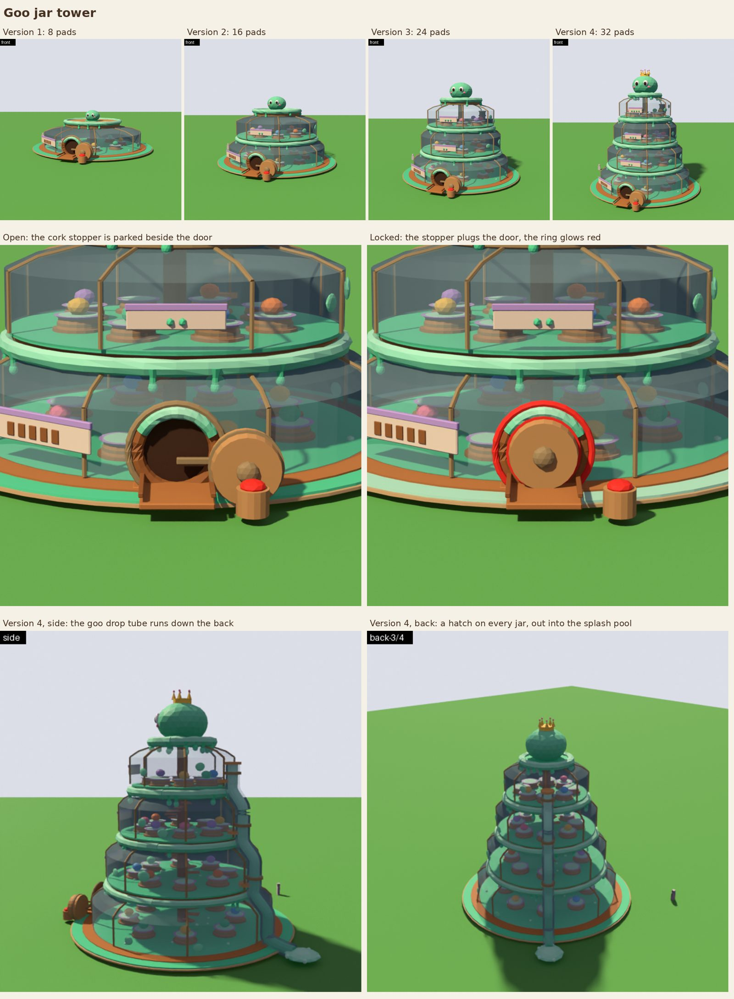

## In the game now

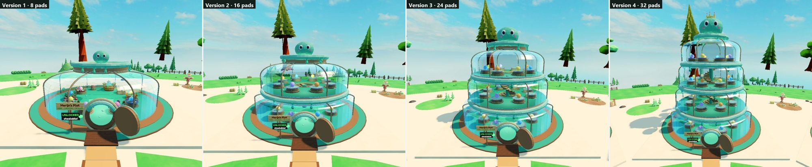

| | |
|---|---|
| 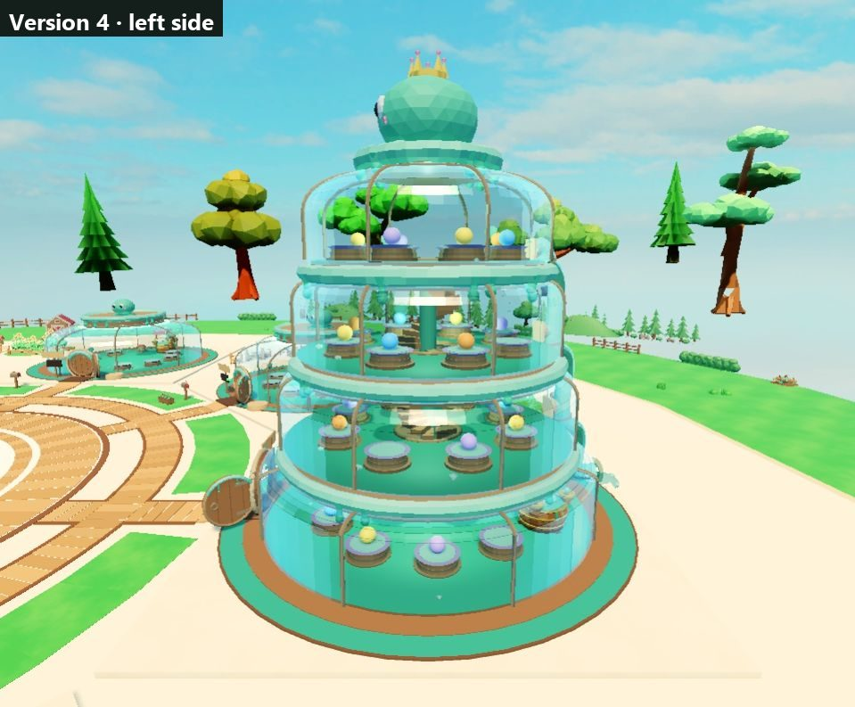 | 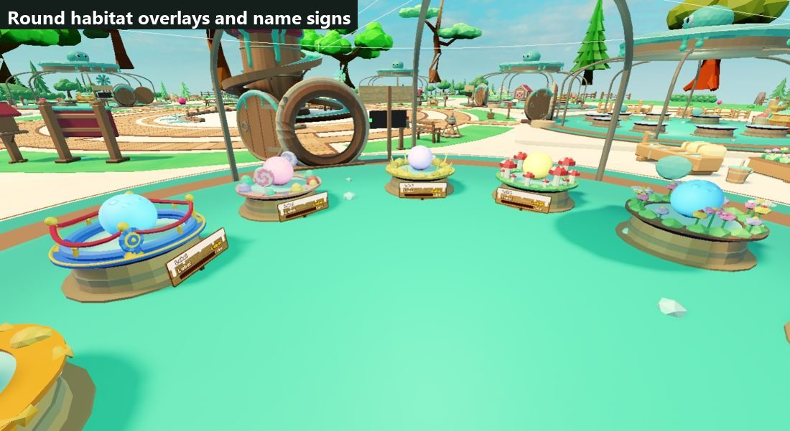 |
| 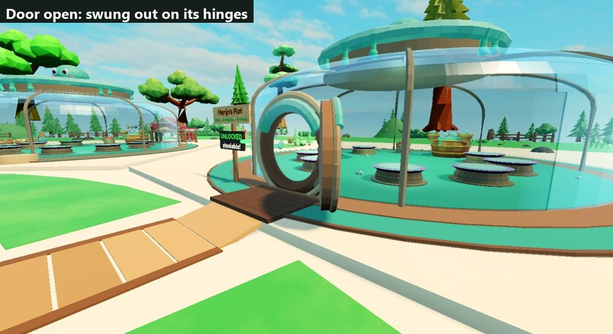 | 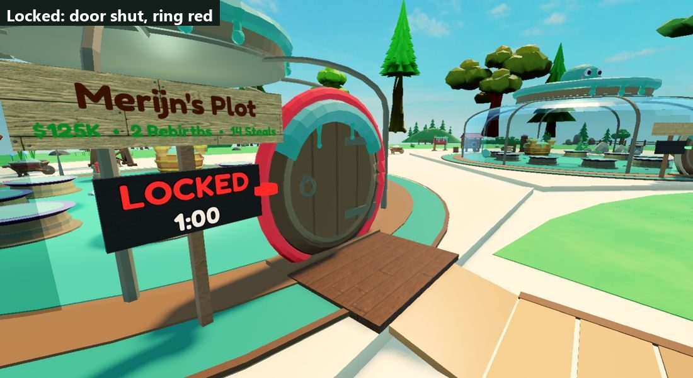 |
| 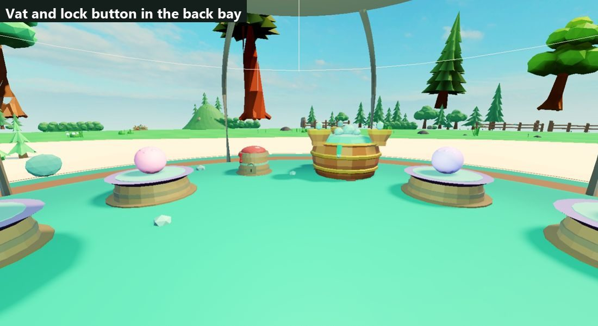 | 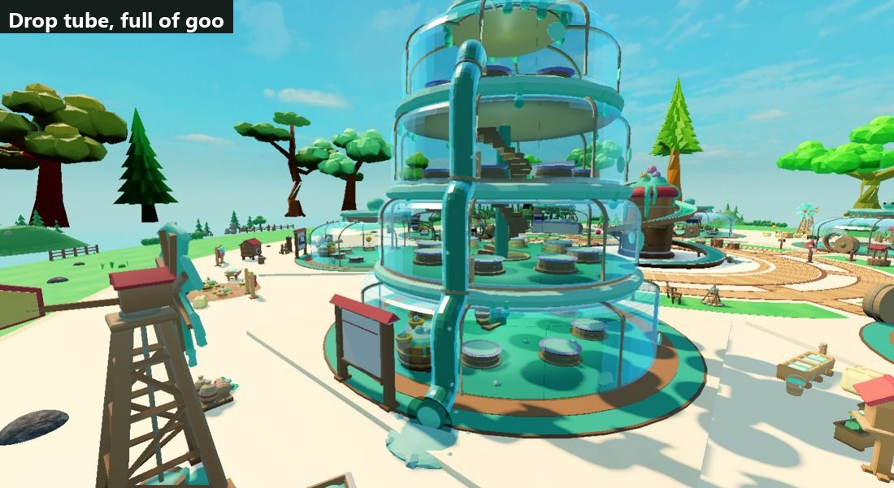 |

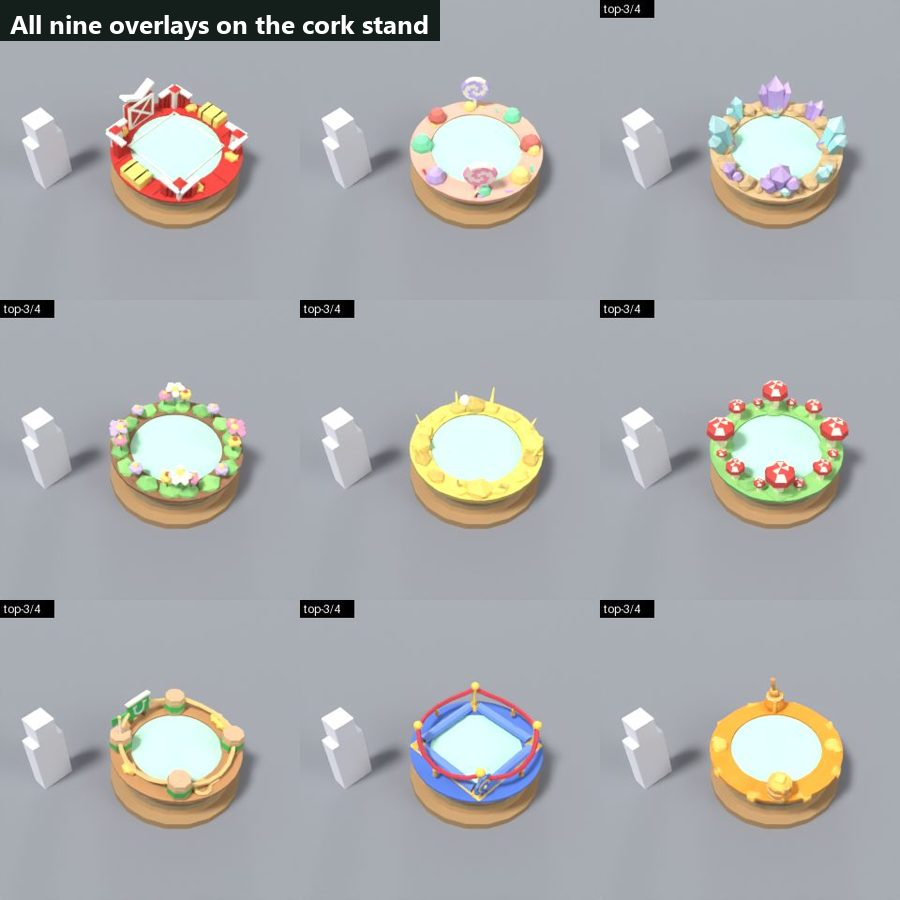

## The design

| Version | Pads | What you see |
|---|---|---|
| 1 | 8 | One glass jar on a wooden foot inside a goo moat. A cork stopper lid, and the slime mascot on top. |
| 2 | 16 | A second, smaller jar on the first. The drop tube starts on the back. |
| 3 | 24 | A third jar. The mascot gets bigger. |
| 4 | 32 | A fourth jar. The mascot gets a crown, and goo spills over the top lid. |

- **Jars.** Each jar is a see-through glass mesh (Glass, transparency 0.7, no shadow, a goo lamp inside) with brass ribs running up over the shoulder to a threaded neck and a cork lid. The next jar stands on that lid. Under the meshes, 12 invisible wall segments per jar do the colliding. There are no labels on the glass.
- **Slime stands.** A round cork pedestal with a brass band and a dish in the plot colour, holding a goo bed. The seat is 2.4 studs high, like the old pads. The stands sit on a ring round the centre, 8 per jar. Each stand collides as a round 7.5-stud cylinder (`PadCollider`). The habitat overlays are round rings on the dish, and the slime's name sign stands on a stake in front of it.
- **Getting around.** You come in through the round door on the front of jar 1. A spiral stair round the centre post climbs one stud per step, up through a hole in each deck. The owner leaves fast by the goo drop tube down the back: a hatch on every upper jar drops them in a splash pool behind the moat. **Only the owner can use the tube, and not while carrying a slime**; everyone else takes the stairs and walks out through the door.
- **Door and lock.** A round plank door on two brass hinges. While the base is open it swings outward and stands beside the doorway; while it's locked it sits shut in the frame and a red ring glows around it. The lock button (a red goo button on a cork stand) and the merge vat stand side by side in a bay at the back of jar 1: locking and merging always happen inside, on the ground floor, so nobody camps an owner's button. The lock status sign and the plot's name board stand on one post by the bridge.
- **Slime vibes.** Goo oozes from under every lid with teardrop drips, a thin goo line runs along the door frame, goo is smeared on the glass and bubbles in the pools, and the mascot slime on top grows with each version.

Palette: the locked Slime Ranch theme (`shared/modeling-kit/THEME.md`): `ranch_goo`, `ranch_goo_hi`, cork (214, 170, 116), brass `ranch_metal`, glass (200, 240, 244), and the plot colour for trim. The only neon is gameplay: the locked ring and the lock button.

### Concepts that were not chosen

| A. Goo jar tower (chosen) | B. Slime tree | C. Floating islands |
|---|---|---|
| 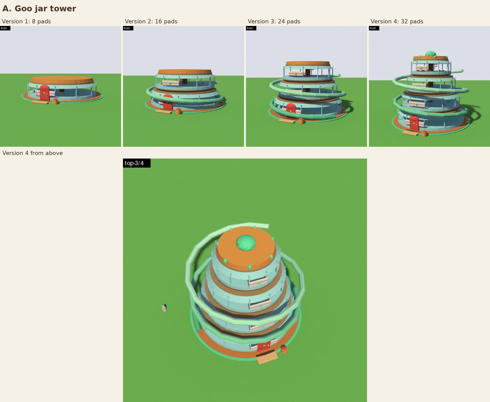 | 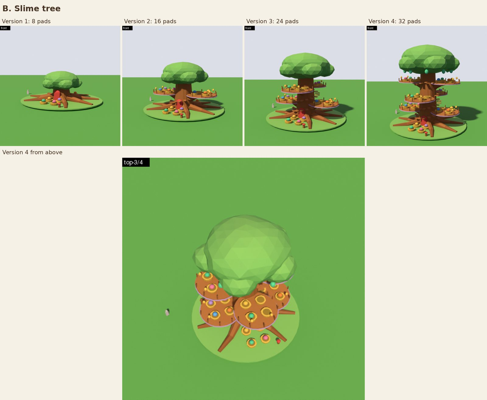 | 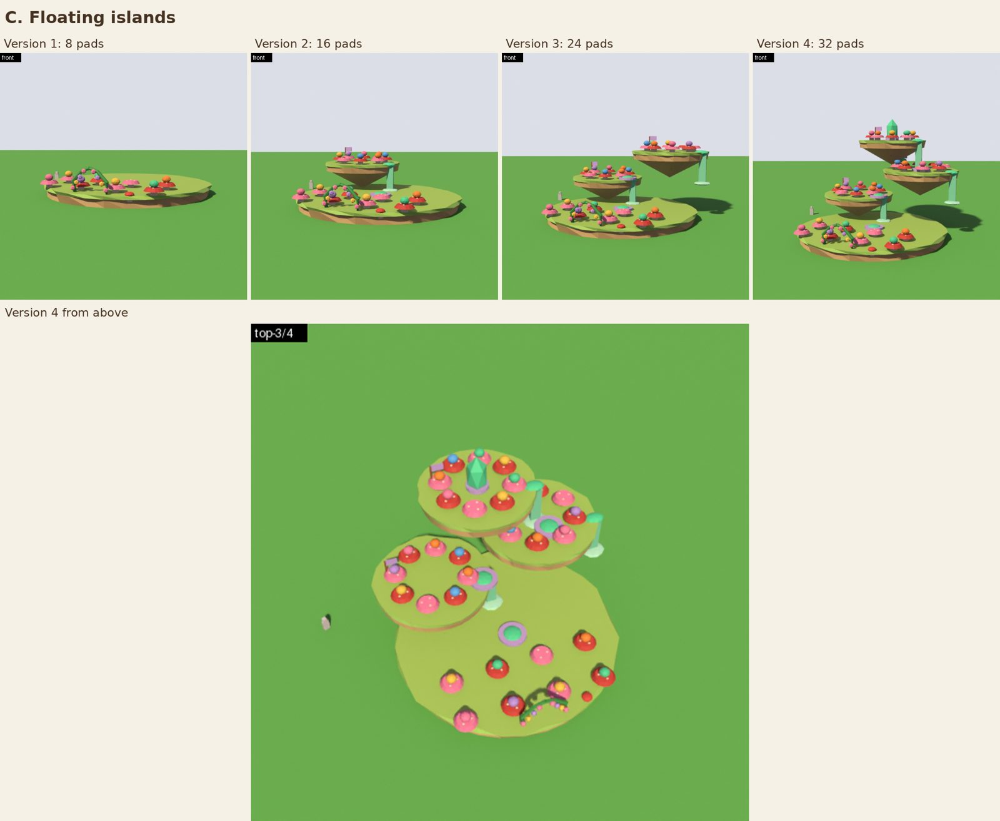 |

The renders come from `shared/modeling-kit/models/_goo_jar_tower_scene.py` (`JAR_V=1..4`, `JAR_LOCKED=1`) and `_base_concepts_scene.py`, made with `iterate.py --look roblox`. They are design blockouts, not upload meshes.

## Decisions made

- 4 versions, 8 pads each, 32 pads in total. Prices are in `Config.BASE_FLOORS`: floor 1 costs 100 ×2.5 per pad, floor 2 starts at 25K, floor 3 at 2.5M and floor 4 at 250M, each ×1.6 per pad. These are first guesses to tune.
- Pads goal: 6 / 8 / 16 / 24 / 32.
- Floors are 16 studs apart. The jar radii are **31 / 27 / 24 / 21.5** (the render's shape), and the pad rings are at **19 / 17 / 15.5 / 14.1**. Floor 1's pads stand 36° apart, leaving the back bay for the vat and the lock button. `tests/JarTower.spec.luau` keeps a 2.5-stud walkway between stands and 3.5 studs to the glass.
- The upper jars are built at runtime (`server/BaseFloors`) only on plots whose owner has them. When the owner leaves, anyone standing in a jar is set down on the ground first.
- Walking stair, not a lift: top-floor steals stay a chase.
- Drop tube: owners only, never while carrying (for now).
- No SlimeDex board on the plots any more. Its plot attributes are gone too.
- No new save field: the version comes from `padsUnlocked`, and old saves load unchanged.

## How it's built

- **Geometry:** `WorldLayout` (jar section) builds jar 1 into the static plot and upper jars through `WorldLayout.floor`. Every look is a mesh slot over invisible primitive colliders.
- **Meshes:** 32 `goo_*` kit meshes (`shared/modeling-kit/models/_goo_jar.py`, numbers from `scripts/export-jar-dims`), placed by `jarLook` from `JarMeshes.luau`. `MeshSwap` reads `MeshMaterial`, `MeshTransparency`, `MeshCastShadow` and `JarHidden` on the slots, and `BaseFloors.setLids` switches each jar between its "top" and "covered" look.
- **Habitat overlays:** authored square and mapped onto the round dish by `overlay_finish` in `_habitat_overlay.py`.
- **Budgets:** static parts 1335 of 1400, mesh slots 397 of 400.

## Checked in a hidden Studio

- Every version from four sides.
- The door open and locked.
- The vat and lock button bay.
- The drop tube goo.
- All habitat overlays on floor 1, with 5-stud test slimes.
- The name signs.
- The round collider (a cylinder, with the square box no longer colliding).

Not checked in Studio: the owners-only and carrier refusals and the floor evacuation, since they need real players (the first two are covered by `tests/DropTube.spec`).

## Still to do

1. Leftover `MeshAssets` entries for the retired `ranch_fence_20`, `phoenix_fence_segment`, `phoenix_gate` and `phoenix_pad_crate` (no slot uses them).
2. Tune the floor prices in a playtest.
