# Translations

Steal a Slime ships translated (house rule 12). This page says how it works, what is and isn't translated, how to
check it, and the Creator Hub steps for each release.

## How it works

```
src/shared/Strings/<Area>.luau     every English string, by key: ["shop.need_more"] = "Need {amount} more"
src/shared/Strings/Data.luau       names and descriptions built from Config (data.<kind>.<id>.<field>)
        │
        ├── scripts/gen-locale ──► locale/Strings.csv ──► LocalizationService.Strings (in the place)
        │                                 └─────────────► uploaded to the cloud localization table
        │                                                 (Roblox automatic translation fills it in)
        ▼
src/ui/Text.luau (client)          Text.t(key, args) → Roblox Translator for the player's language
src/server/WorldText.luau          prompts and world labels: English + the message in an attribute;
                                   each client writes its own language (shared LocalizedTree)
```

- The shared library holds the game-agnostic part: `shared/luau/src/locale` (`Localize`, `LocaleFonts`,
  `RobloxTranslator`, `LocalizedTree`), with Lune specs.
- Keys are stable; the English source is a whole sentence with named parameters (`{amount}`, `{name}`), so a
  translation can move words around. A translation that loses or adds a parameter falls back to English.
- Look-up order on the client: the key in the cloud table (the uploaded CSV, translated by Roblox), then the same
  English text if Roblox captured it itself, else English.
- The UI's own labels have `AutoLocalize` off (they are already translated by `Text`), so Roblox's text capture does
  not fill the cloud table with translated or one-off text. That is why the CSV upload below is needed.
- The player's language is read when they join. Changing the Roblox language mid-session applies on the next join.

### What stays English, on purpose

- Player names, slime species names and boss names (proper nouns), the game's name, redeem codes.
- Numbers keep the shared formatter: `$1.25K`, `R$99`, `4m 05s`, `x3`.
- The admin menu and Studio-only tools.
- Server `Notify` texts: they are never shown (only their sound plays).

### Not covered yet

- Text baked into images: thumbnails, store icons, any decal with words.
- Sounds and voice (none have words today).
- The experience name and description: Creator Hub translates these separately (step 4 below).
- Roblox's own UI (purchase prompts, leaderboard header) is translated by Roblox; Game Pass and Developer Product
  names come from the platform and are translated in Creator Hub, not here.

## Languages

All languages Roblox automatic translation supports (Creator Hub, 2026-11-06): Spanish, Portuguese, German, French,
Italian, Indonesian, Turkish, Russian, Polish, Vietnamese, Japanese, Korean, Chinese (Simplified), Chinese
(Traditional), Thai, Hindi, Arabic. Dutch is not supported by automatic translation.

Fonts (checked in Studio): Fredoka One, the title and button font, only draws Western European letters. For every
other language `Text.displayFont()` swaps it for Nunito Heavy (`Widgets.create`), which draws Cyrillic and extended
Latin itself; Roblox's CJK, Hangul and Thai fallback font matches its weight. Body text (Nunito Bold) works in all.
Arabic and Hindi fall back to Roblox's font; Arabic is right-to-left and our layouts are not mirrored, so it reads
correctly but looks left-aligned.

## Adding or changing a string

1. Add the key to the area's `Strings/<Area>.luau` (a string with parameters gets an `example`).
2. Draw it with `Text.t(key, args)` (client), `WorldText.set(...)` (server world text), or send `Localize.msg(key,
   args)` in a result or State field and draw it with `Text.text(value)`. Translate when drawing, never at require
   time.
3. `lune run scripts/gen-locale` (`tests/Locale.spec` fails while `locale/Strings.csv` is stale).
4. After the release: upload the new CSV (step 2 below).

## Checks

- `tests/ui/Translations.spec`: the menus in the long-text pseudo-language (accented letters, about 40% longer):
  any plain English left is a string that skipped `Text`; fixed-size labels must fit the longer text.
- `tests/Locale.spec`, `tests/LocaleData.spec`: catalog rules, the CSV is fresh, Config data has its keys.
- In Studio: set the attribute `TestLocale` on `LocalizationService` before Play (`pseudo`, or a locale id such as
  `ru-ru`; Studio only). With a real language, Studio loads the cloud table's translations.

- Long text in a fixed box: `Widgets.fitText(label)` keeps the design size while the text fits, shrinks it to fit,
  never under `Layout.MIN_TEXT` (14 px). It does nothing in English (English is laid out to fit).

## Studio check, 2026-11-06

A hidden, muted Studio on the memory store, pseudo-language forced, every menu opened at the six gate viewports
(390x844, 844x390, 768x1024, 1024x768, 1366x768, 1920x1080), Roblox's own `TextFits` read on every visible label.

- Every menu and the HUD are translated: the only plain English left is slime species and player names (by design).
- Server-made world text (prompts, signs, vat and ritual boards) follows each client's language.
- Russian (a few test strings injected for the check, not shipped): text, nav and world signs render in Nunito Heavy.

| Pseudo-language | Russian |
|---|---|
| 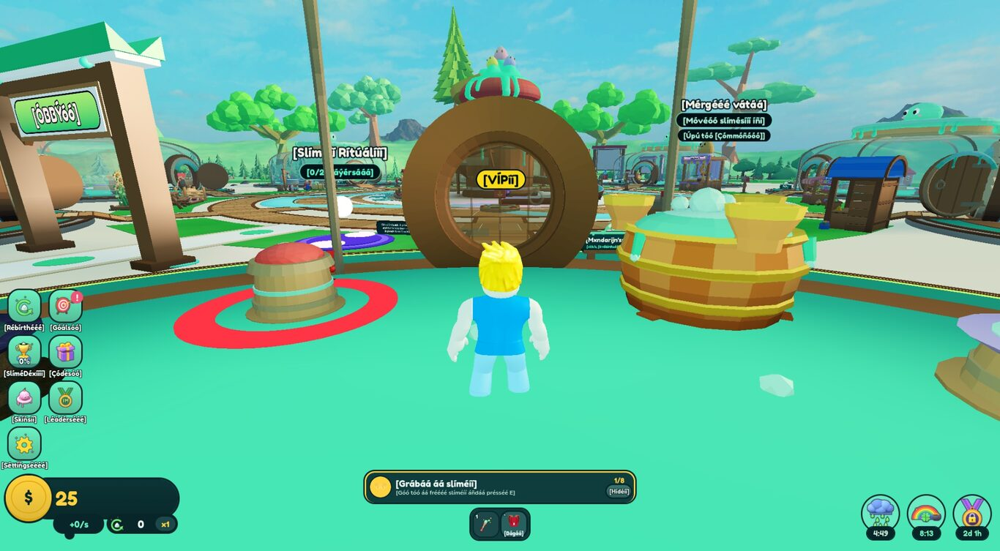 | 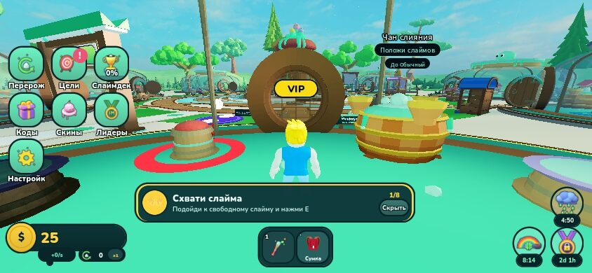 |
| 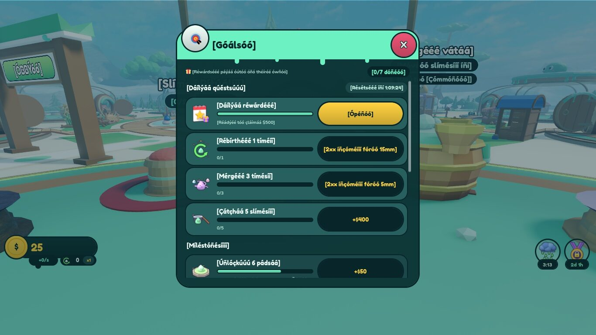 | 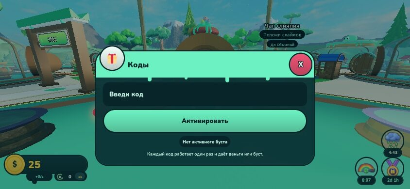 |
| 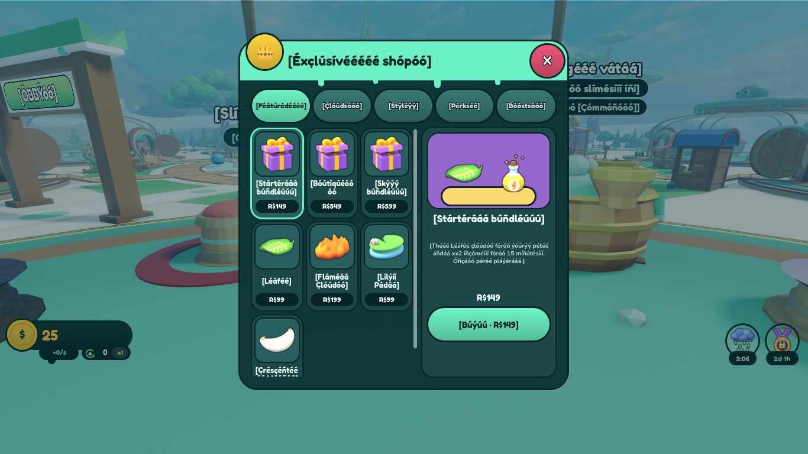 | 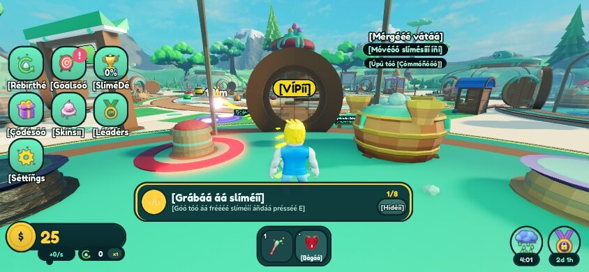 |

Font check (Fredoka One, Nunito Bold, Nunito Heavy, Builder Sans Heavy): 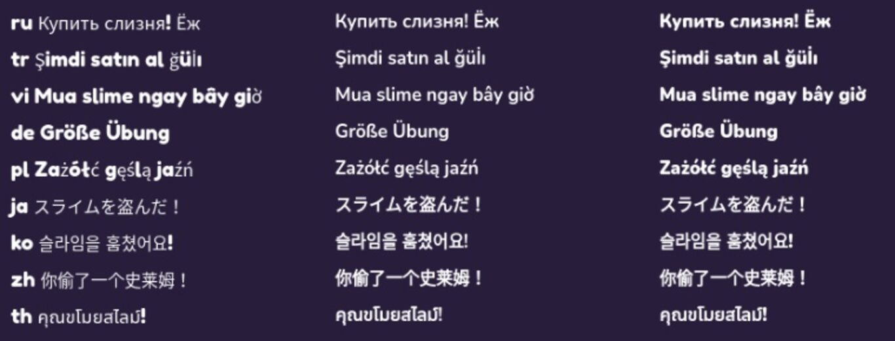

### Layout decision

**Decided (Merijn, 2026-11-07): "A + C".** A: two-line labels in the spots below, 14 px stays the minimum (no
12 px). C: short hand-written translations, for the 17 languages, for the one-word labels that still don't fit.
How it is built and the before/after are in "Long text (A + C)" below.

Before: labels whose pseudo text did not fit even at 14 px (labels per screen size; the pseudo-language is about 60% longer
than English with its brackets, real German or Spanish 30-60%):

| Where | Phones / tablet | 1366x768 | 1920x1080 | Real example |
|---|---|---|---|---|
| Nav tile labels | 7 | 4 | 1 | "Настройки", "Einstellungen" for Settings |
| Exclusive shop card names, Featured tab | 6 | 1 | 1 | "Paquete de inicio" |
| Skins list titles | 3-8 | 0 | 0 | "Rancho embrujado" |
| Goals row detail ("0/10K · Stage 1 of 4") and long titles | 1-14 | 1 | 1 | |
| Merge result title and odds (the 118 px column beside the orb) | 2 | 1 | 1 | |
| Welcome daily tiles ("Day 1", "Egg") | 2-3 | 0 | 0 | |
| Leaderboard tabs, Dex pane rarity | 1-2 | 0 | 0 | |

Options:
- **A.** Two-line nav labels and list titles (wrap at the space, same 14 px), the merge result column 30 px wider.
- **B.** Allow 12 px for non-English text in these spots only (against the 14 px floor in the style guide).
- **C.** Shorter manual translations for the dozen UI words that overflow (nav names, "Stage"), locked in Creator Hub
  so automatic translation keeps them.

### Long text (A + C)

- `Text.longText()` is true in every language but English. In English nothing changes; in long-text mode the spots
  above get room for two lines at their own text size (never under 14 px, `Widgets.fitText`), and whatever sits
  under them moves down:
  - Nav tiles: two-line labels (16 px, 14 px on phones); the nav rows grow and a short screen gets more columns
    (`Layout.screen(w, h, { longText })`).
  - Skins rows and Goals rows: two-line titles; the Goals detail line takes the whole text column with "Next:" on
    its own line under it; the rows grow.
  - Exclusive shop: card names get three lines, tags two, tabs wrap; WorldShop Buy buttons wrap.
  - Merge result column 30 px wider (148 px; the arrow and the gaps beside it give the room), two-line title.
  - Welcome daily tiles: two-line day and reward words; the card grows to fit.
- C: `src/shared/Strings/Short.luau` holds short translations for 13 one-word labels (nav names, the Featured and
  leaderboard tabs, "Stage", "Day", "Egg") in the 17 languages. `scripts/gen-locale` writes them into
  `locale/Strings.csv` as locale columns (`ar`, `de`, ... `zh-hans`, `zh-hant`; a player's locale falls back to its
  language, checked in Studio), so the place answers them and the cloud table gets them as manual entries that
  automatic translation leaves alone. They were written by the AI: a native speaker should check them.

Studio check after (2026-11-07, hidden and muted, memory store, pseudo-language, every menu at the six gate
viewports, Roblox's `TextFits`): labels that don't fit at 14 px.

| Viewport | Before | After | What is left |
|---|---|---|---|
| 390x844 | 43 | 10 | single pseudo words: 6 nav labels, 2 leaderboard tabs, "Day 1", one rarity |
| 844x390 | 22 | 12 | the same words, 4 Exclusive card names |
| 768x1024 | 21 | 11 | nav words, "Day 1", 4 Exclusive card names |
| 1024x768 | 21 | 11 | the same |
| 1366x768 | 7 | 0 | |
| 1920x1080 | 4 | 0 | |

What is left is one-word labels (a word can't wrap, and the pseudo-language makes "Settings" 75% longer); in real
languages the short translations (C) cover the nav names, the tabs and "Day". The Exclusive card names left (the
bundles in Studio; a base and two potions in `tests/ui/ExclusiveShop.spec`'s `LONG_KNOWN`) need a fourth line only
in the pseudo-language; four lines would make every long-text card about 40 px taller.

| Before (pseudo) | After (pseudo) |
|---|---|
|  | 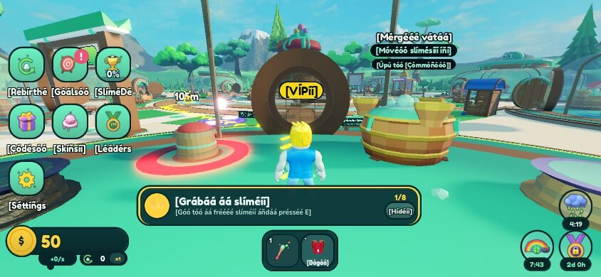 |
|  | 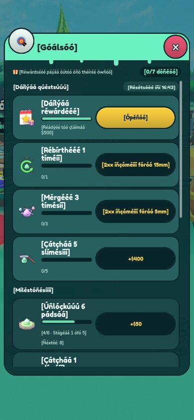 |
|  | 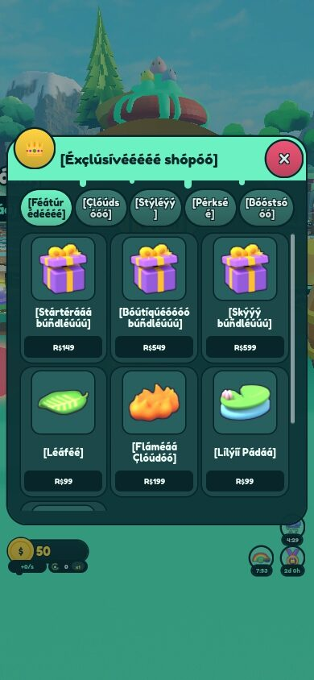 |
| | 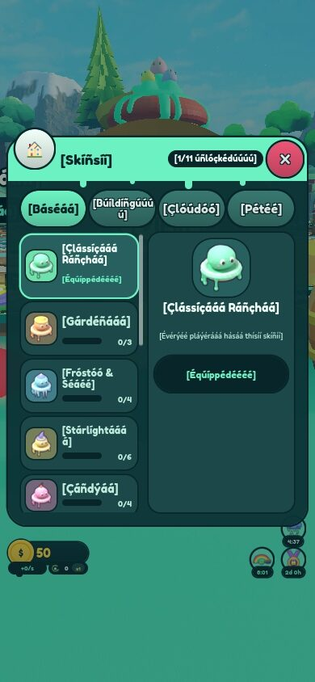 |

German with the shipped short translations (nav: "Ziele", "Top", "Optionen"; the rest is English until Roblox
translates the table): 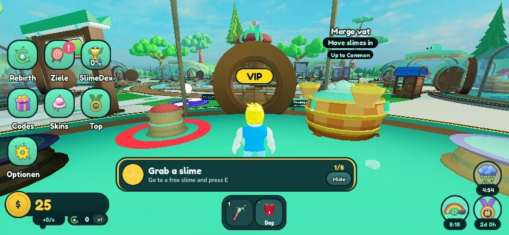

Not covered: the English compact nav label is 13 px (`Layout.NAV.clabelSize`), under the 14 px floor; it is
unchanged here (English), and long-text mode uses 14 px.

## Creator Hub steps (Merijn)

Experience: Steal a Slime, universe 10774962286. Creator Hub → the experience → Localization.

Do these only after the version with this code is live; until then leave "Use Translated Content" off.

1. **Settings**: keep "Capture text from experience UI while users play" on (already on). It still catches text
   outside our UI (world text Roblox shows itself).
2. **Upload the table**: Localization → the localization table → Upload CSV (or "Import"), and pick
   `games/steal-a-slime/locale/Strings.csv` from the release commit. It adds the keyed English entries; Roblox only
   machine-translates blank entries, so existing translations are kept. Do this again after every release that adds
   strings.
3. **Languages**: add the languages listed above and turn on automatic translation for "Experience Strings &
   Products" for each.
4. Optional: also turn on automatic translation for "Experience Information" (name and description).
5. Wait until the table shows translations (usually minutes; the quota is per character and language), then
   **Settings → Use Translated Content: on**.
6. Spot check: join with Roblox set to Spanish and to Russian or Japanese; open the shop, Goals and Settings.
   Check a string with a parameter (e.g. a price) shows the number in the right place.
